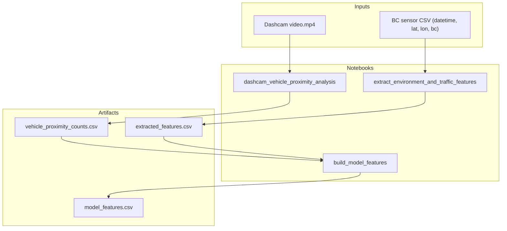

# Dashcam Black-Carbon Feature Pipeline

Jupyter notebooks that turn **dashcam video**, **black-carbon (BC) time-series CSVs**, and **external weather/traffic APIs** into an aligned feature table for downstream modeling.

---

## Contents

- [What this repository does](#what-this-repository-does)
- [Pipeline at a glance](#pipeline-at-a-glance)
- [Repository layout](#repository-layout)
- [Prerequisites](#prerequisites)
- [Environment setup](#environment-setup)
- [Secrets and API keys](#secrets-and-api-keys)
- [Working directory](#working-directory)
- [Quick start](#quick-start)
- [Notebook reference](#notebook-reference)
- [Dependencies](#dependencies)
- [Troubleshooting](#troubleshooting)

---

## What this repository does


| Stage                        | Notebook                                              | Output                                                     |
| ---------------------------- | ----------------------------------------------------- | ---------------------------------------------------------- |
| Optional clip split          | `Code/video_manipulation_utility.ipynb`               | Shorter MP4 clips under `Artifacts/video_clips/`           |
| Vehicle proximity from video | `Code/dashcam_vehicle_proximity_analysis.ipynb`       | Annotated video + proximity interval CSV                   |
| Weather + traffic            | `Code/extract_environment_and_traffic_features.ipynb` | `Artifacts/extracted_features.csv`                         |
| Merge env + vehicle bins     | `Code/build_model_features.ipynb`                     | `Artifacts/model_features.csv`                             |
| EDA & modeling               | `Code/Modeling and Visualization/`                    | Figures, metrics, SHAP exports                             |


Place YOLO weights at `Code/yolov8n.pt` (or set `MODEL_WEIGHTS` in the dashcam notebook).

---

## Pipeline at a glance

1. **Video** → `dashcam_vehicle_proximity_analysis.ipynb` → interval vehicle-count CSV.
2. **BC CSV** → `extract_environment_and_traffic_features.ipynb` → `extracted_features.csv` (weather + traffic).
3. **Both CSVs** → `build_model_features.ipynb` → `model_features.csv` (aligned bins).
4. **Optional** → `Code/Modeling and Visualization/` for EDA and predictive modeling.



Optional utilities under `Code/Helpers/` support video splicing and route coverage analysis.

**APIs:** Open-Meteo (no key) + TomTom flow segments (`TOMTOM_API_KEY` in the environment — see [Secrets and API keys](#secrets-and-api-keys)).

---

## Repository layout

```text
.
├── README.md
├── Artifacts/                    # Create locally; large inputs/outputs (not in git)
│   ├── BC_raw_data.csv
│   ├── dashcam_input.mp4
│   ├── extracted_features.csv
│   ├── vehicle_proximity_counts.csv
│   └── model_features.csv
└── Code/
    ├── video_manipulation_utility.ipynb
    ├── dashcam_vehicle_proximity_analysis.ipynb
    ├── extract_environment_and_traffic_features.ipynb
    ├── build_model_features.ipynb
    ├── yolov8n.pt
    ├── Helpers/
    │   ├── route_tracer.ipynb
    │   └── video_splicer.ipynb
    └── Modeling and Visualization/
        ├── README.md
        ├── bc_config.py
        ├── bc_eda.py
        ├── bc_modeling.py
        ├── bc_eda_visualization.ipynb
        └── bc_predictive_modeling.ipynb
```

---

## Prerequisites

- **Python 3.10** (Conda or another manager)
- **Jupyter** (or an IDE with a Jupyter kernel)
- **ffmpeg** and **ffprobe** on `PATH` (video splitting / splicing notebooks)

On macOS with Homebrew:

```bash
brew install ffmpeg
ffmpeg -version && ffprobe -version
```

---

## Environment setup

```bash
conda create -n bc-pipeline python=3.10 -y
conda activate bc-pipeline
python -m pip install --upgrade pip
pip install ultralytics opencv-python pandas numpy jupyter ipykernel requests tqdm
```

Register a kernel:

```bash
python -m ipykernel install --user --name bc-pipeline --display-name "bc-pipeline"
```

Select the **bc-pipeline** kernel when running notebooks.

For modeling extras, see `Code/Modeling and Visualization/requirements.txt`.

### Apple Silicon (optional)

`ultralytics` pulls in PyTorch; MPS may be used when available. If you hit backend issues, follow the official install guide: [PyTorch — Get Started](https://pytorch.org/get-started/locally/).

---

## Secrets and API keys

- **Do not commit API keys, tokens, or `.env` files** with real values.
- **TomTom:** export the key before starting Jupyter:

  ```bash
  export TOMTOM_API_KEY="your_key_here"
  jupyter lab
  ```

  If unset, traffic calls are skipped and `TT_*` columns may be empty.

---

## Working directory

If the current working directory is `Code/`, notebooks treat the parent folder as the project root; otherwise the cwd is used as root.

For predictable paths, start Jupyter from the repository root (the folder that contains `Code/` and `Artifacts/`).

---

## Quick start

1. `conda activate bc-pipeline`
2. Create `Artifacts/` and add your BC CSV, dashcam video, and YOLO weights.
3. `export TOMTOM_API_KEY=...` when running the extraction notebook.
4. Run notebooks under `Code/` as needed:
   - Optional: `video_manipulation_utility.ipynb`
   - `dashcam_vehicle_proximity_analysis.ipynb`
   - `extract_environment_and_traffic_features.ipynb`
   - `build_model_features.ipynb`
   - Optional: notebooks in `Modeling and Visualization/`

---

## Notebook reference

### `video_manipulation_utility.ipynb`

Splits `VIDEO_PATH` into `N_CLIPS` equal-duration segments under `OUTPUT_DIR`.

### `dashcam_vehicle_proximity_analysis.ipynb`

YOLO detection/tracking for `car`, `bus`, and `truck`; proximity bands from bounding-box area; stopped state from box stability and scene motion. Writes annotated video and per-interval CSV.

### `extract_environment_and_traffic_features.ipynb`

Enriches rows with `datetime`, `lat`, `lon`, `bc` using Open-Meteo weather and TomTom flow-segment fields (`TT_*`). Supports chunked runs.

### `build_model_features.ipynb`

Aligns 1 Hz environmental rows with vehicle interval counts into bins of width `BIN_DURATION_SECONDS`.

### Helpers

- `Helpers/route_tracer.ipynb` — GPS route coverage, overlap ranking, map overlays (expects `datetime_local`, `lat`, `lon`).
- `Helpers/video_splicer.ipynb` — splice dashcam video to proximity CSV timestamps.

### Modeling

See [`Code/Modeling and Visualization/README.md`](Code/Modeling%20and%20Visualization/README.md).

---

## Dependencies


| Package                | Role                             |
| ---------------------- | -------------------------------- |
| `ultralytics`          | YOLO models and tracking         |
| `opencv-python`        | Video I/O and overlays           |
| `numpy`, `pandas`      | Arrays and tables                |
| `requests`             | Open-Meteo and TomTom HTTP calls |
| `tqdm`                 | Progress bars                    |
| `jupyter`, `ipykernel` | Notebook execution               |
| `ffmpeg` / `ffprobe`   | Clip splitting (system)          |


---

## Troubleshooting


| Symptom                            | What to try                                                                 |
| ---------------------------------- | --------------------------------------------------------------------------- |
| Wrong imports / kernel             | Select the `bc-pipeline` kernel; run `pip list` in that environment.        |
| `ModuleNotFoundError: ultralytics` | `conda activate bc-pipeline` then `pip install ultralytics`.                |
| `ffmpeg` not found                 | Install ffmpeg and restart the terminal / Jupyter.                          |
| Empty or missing `TT_*` columns    | Confirm `TOMTOM_API_KEY`, quota, and road coverage for your coordinates.    |
| Misaligned times in merge          | Use timezone-aware datetimes; match `BIN_DURATION_SECONDS` to vehicle bins. |
| Slow dashcam run                   | Shorter clips, lower export resolution, or tune confidence / device.        |
| Long TomTom runs                   | Use chunk settings; skip finished chunks.                                   |
