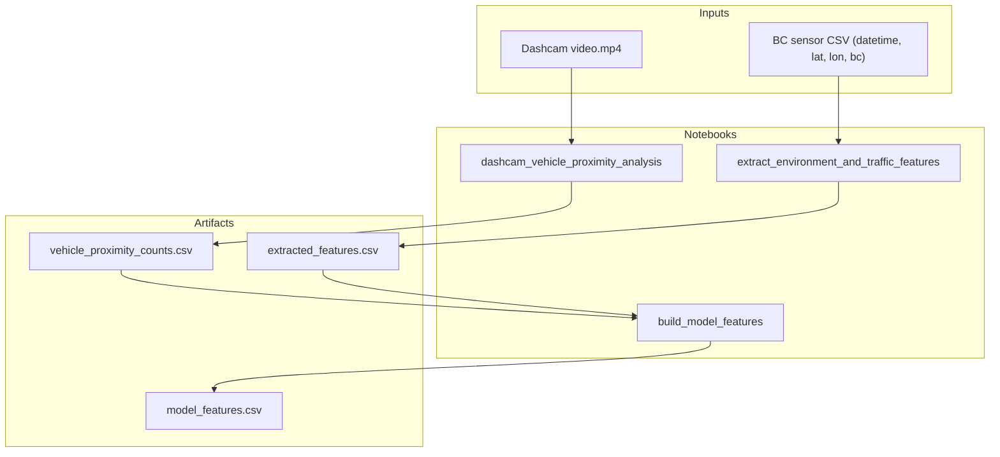

# BC CV — Dashcam, BC sensors, and modeling features

Pipeline of Jupyter notebooks that turn **dashcam video**, **BC (black carbon) time-series CSVs**, and **external weather/traffic APIs** into a single aligned table for downstream modeling.

---

## Contents

- [What this repository does](#what-this-repository-does)
- [Pipeline at a glance](#pipeline-at-a-glance)
- [Repository layout](#repository-layout)
- [Prerequisites](#prerequisites)
- [Environment setup](#environment-setup)
- [Secrets and API keys](#secrets-and-api-keys)
- [Working directory](#working-directory)
- [Quick start](#quick-start)
- [Notebook reference](#notebook-reference)
- [Dependencies](#dependencies)
- [Troubleshooting](#troubleshooting)

---

## What this repository does


| Stage                        | Notebook                                              | Output                                                     |
| ---------------------------- | ----------------------------------------------------- | ---------------------------------------------------------- |
| Optional clip split          | `Code/video_manipulation_utility.ipynb`               | Shorter MP4 clips under `Artifacts/video_clips/`           |
| Vehicle proximity from video | `Code/dashcam_vehicle_proximity_analysis.ipynb`       | Annotated video + `Artifacts/vehicle_proximity_counts.csv` |
| Weather + TomTom traffic     | `Code/extract_environment_and_traffic_features.ipynb` | `Artifacts/extracted_features.csv` (+ optional chunk CSVs) |
| Merge env + vehicle bins     | `Code/build_model_features.ipynb`                     | `Artifacts/model_features.csv`                             |


Weights for YOLO are expected at `**Code/yolov8n.pt`** (Ultralytics default naming), or change `MODEL_WEIGHTS` in the dashcam notebook.

---

## Pipeline at a glance

Two inputs are processed in parallel, then combined:

1. **Video** → `dashcam_vehicle_proximity_analysis.ipynb` → `vehicle_proximity_counts.csv` (interval counts).
2. **BC CSV** → `extract_environment_and_traffic_features.ipynb` → `extracted_features.csv` (1 Hz weather + traffic).
3. **Both CSVs** → `build_model_features.ipynb` → `model_features.csv` (aligned bins for modeling).




Optional: run `video_manipulation_utility.ipynb` first to split a long recording into shorter clips for step 1.

**APIs:** Open-Meteo (no key) + TomTom flow segments (`**TOMTOM_API_KEY`** in your environment — see [Secrets and API keys](#secrets-and-api-keys)).

---

## Repository layout

```text
.
├── README.md
├── Artifacts/                    # Create locally; large inputs/outputs (not required in git)
│   ├── BC_raw_data.csv           # Your sensor file (example name; adjust in notebook)
│   ├── dashcam_input.mp4         # Example input name used by notebooks
│   ├── extracted_features.csv
│   ├── vehicle_proximity_counts.csv
│   └── model_features.csv
└── Code/
    ├── video_manipulation_utility.ipynb
    ├── dashcam_vehicle_proximity_analysis.ipynb
    ├── extract_environment_and_traffic_features.ipynb
    ├── build_model_features.ipynb
    └── yolov8n.pt                # Or another checkpoint you prefer
```

Place videos and CSVs under `**Artifacts/**` or edit the path variables in each notebook.

---

## Prerequisites

- **Python 3.10** (Conda or another manager)
- **Jupyter** (or VS Code / Cursor with a Jupyter kernel)
- `**ffmpeg` and `ffprobe`** on your `PATH` (required for the video splitting notebook)

On macOS with Homebrew:

```bash
brew install ffmpeg
ffmpeg -version && ffprobe -version
```

---

## Environment setup

Create and activate an environment, then install packages:

```bash
conda create -n bc-cv python=3.10 -y
conda activate bc-cv
python -m pip install --upgrade pip
pip install ultralytics opencv-python pandas numpy jupyter ipykernel requests tqdm
```

Register a kernel for Jupyter:

```bash
python -m ipykernel install --user --name bc-cv --display-name "bc-cv"
```

Select the **bc-cv** kernel when running notebooks.

### Apple Silicon (optional)

`ultralytics` pulls in PyTorch; MPS may be used when available. If you hit backend issues, follow the official install guide: [PyTorch — Get Started](https://pytorch.org/get-started/locally/).

---

## Secrets and API keys

- **Do not commit API keys, tokens, or `.env` files** with real values.
- **TomTom:** export the key in your shell before starting Jupyter, for example:
  ```bash
  export TOMTOM_API_KEY="your_key_here"
  jupyter lab
  ```
  The extraction notebook reads **`TOMTOM_API_KEY`** from the environment. If it is unset, traffic calls are skipped and `TT_*` columns may be empty.
- If a key was ever committed locally, **rotate it** in the TomTom developer portal before publishing the repository.

---

## Working directory

Notebooks resolve the repository root with a small helper: if the current working directory is `**Code/`**, the parent folder is treated as the project root; otherwise the cwd is used as root.

For the most predictable behavior, **start Jupyter from the repository root** (the folder that contains `Code/` and `Artifacts/`).

---

## Quick start

1. `conda activate bc-cv` (or your chosen environment).
2. Create `**Artifacts/`** and add your BC CSV, dashcam video, and (if used) `yolov8n.pt` under `**Code/**`.
3. `export TOMTOM_API_KEY=...` when running `extract_environment_and_traffic_features.ipynb`.
4. Open notebooks under `**Code/**` and run in order as needed:
  - Optional: `video_manipulation_utility.ipynb`
  - `dashcam_vehicle_proximity_analysis.ipynb` — set `VIDEO_PATH` / `START_DATETIME` / `SAMPLE_EVERY_SECONDS` in the config cell.
  - `extract_environment_and_traffic_features.ipynb` — set `INPUT_CSV`, chunk options, and paths if they differ from defaults.
  - `build_model_features.ipynb` — set `BIN_DURATION_SECONDS` to match the vehicle CSV interval width; confirm `ENV_PATH` and `VEHICLE_PATH`.

---

## Notebook reference

### `video_manipulation_utility.ipynb`

Splits `**VIDEO_PATH**` into `**N_CLIPS**` equal-duration segments under `**OUTPUT_DIR**`, with optional stream copy vs re-encode (`STREAM_COPY`).

### `dashcam_vehicle_proximity_analysis.ipynb`

YOLO detection and tracking for **car**, **bus**, and **truck**; proximity bands (`close` / `medium` / `far`) from bounding-box area; **stopped** state using box stability and scene motion thresholds. Writes an annotated MP4 and a per-interval CSV. Interval length is `**SAMPLE_EVERY_SECONDS`**.

### `extract_environment_and_traffic_features.ipynb`

Reads rows with `**datetime**`, `**lat**`, `**lon**`, `**bc**`; enriches with Open-Meteo archive weather and TomTom flow segment fields (`TT_*`). Supports **chunked** runs and a combine step to `**FINAL_OUTPUT_CSV`**.

### `build_model_features.ipynb`

Aligns 1 Hz environmental rows with vehicle interval counts: aggregates env columns into bins of width `**BIN_DURATION_SECONDS**`, applies BC preprocessing and categories, and **inner-merges** on overlapping time ranges. Writes `**Artifacts/model_features.csv`**.

---

## Dependencies


| Package                | Role                             |
| ---------------------- | -------------------------------- |
| `ultralytics`          | YOLO models and tracking         |
| `opencv-python`        | Video I/O and overlays           |
| `numpy`, `pandas`      | Arrays and tables                |
| `requests`             | Open-Meteo and TomTom HTTP calls |
| `tqdm`                 | Progress bars                    |
| `jupyter`, `ipykernel` | Notebook execution               |
| `ffmpeg` / `ffprobe`   | Clip splitting (system)          |


---

## Troubleshooting


| Symptom                            | What to try                                                                                 |
| ---------------------------------- | ------------------------------------------------------------------------------------------- |
| Wrong imports / kernel             | Select the `bc-cv` kernel; run `pip list` in that environment.                              |
| `ModuleNotFoundError: ultralytics` | `conda activate bc-cv` then `pip install ultralytics`.                                      |
| `ffmpeg` not found                 | Install ffmpeg and restart the terminal / Jupyter.                                          |
| Empty or missing `TT_*` columns    | Confirm `TOMTOM_API_KEY`, quota, and coordinates on TomTom-supported roads.                 |
| Misaligned times in merge          | Use timezone-aware datetimes; match `**BIN_DURATION_SECONDS**` to the vehicle CSV interval. |
| Slow dashcam run                   | Shorter clips, lower resolution export, or tune confidence / device per Ultralytics docs.   |
| Long TomTom runs                   | Use chunk settings; avoid re-querying chunks that already finished.                         |


